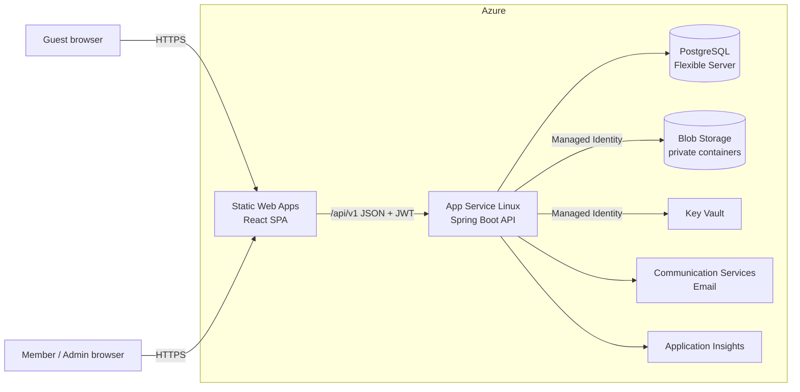
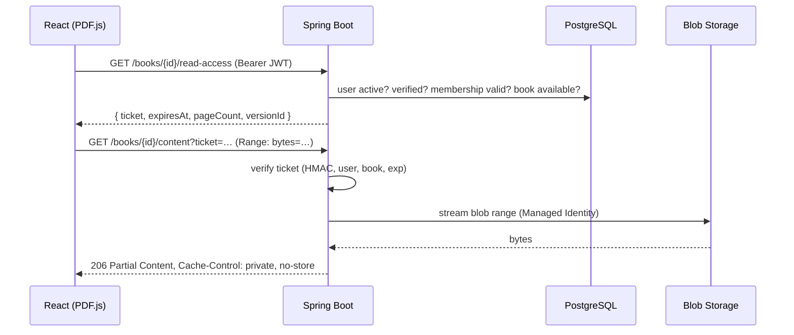

# Architecture

## 1. System context



The browser never talks to Blob Storage directly: covers and PDFs are streamed through the API
(see SECURITY.md §5 for the trade-off).

## 2. Backend: modular monolith

```
backend/src/main/java/com/example/songbook/
  config/          AppProperties, Clock, OpenAPI
  common/          ApiError, PageResponse, exceptions, global handler
  security/        SecurityConfig, JWT filter (P3), rate limiting (P3)
  auth/            register, verify, login, refresh, logout, forgot/reset (P3)
  user/ role/      users, roles, admin user management (P4)
  membership/      membership records + MembershipValidity rule (P4)
  category/        categories (P5)
  book/            books, versions, BookAvailability rule (P5/7)
  file/storage/    FileStorageService + Local / AzureBlob impls (P5/6)
  reader/          access tickets, PDF streaming, progress (P8/9)
  modification/    member requests (P9)
  audit/           audit log writer + query (P9)
```

Rules: controllers are thin and return DTOs only; services own transactions and business rules;
infrastructure (storage, email, clock) sits behind interfaces; constructor injection only.

## 3. Key decisions (ADR summary)

| # | Decision | Rationale / trade-off |
|---|----------|----------------------|
| ADR-1 | Modular monolith, single deployable | Small team, one catalogue; microservices out of scope |
| ADR-2 | Spring Boot 3.5, Java 21, Maven | As specified; 3.5 is the current 3.x line |
| ADR-3 | Stateless JWT access token (15 min) in memory + opaque refresh token (14 days) in `HttpOnly; Secure; SameSite=Strict` cookie scoped to `/api/v1/auth`, rotated on each use, reuse detection revokes the family | No long-lived token in `localStorage`; refresh endpoint is CSRF-safe via SameSite + Origin check |
| ADR-4 | PDF delivery by **authenticated backend streaming** with a 60-second access ticket, not SAS | Keeps eligibility checks on every request, no signed URL can leak into logs/history/analytics, works identically with local storage. Cost: API bandwidth. Mitigated by HTTP Range support and App Service scaling; revisit with user-delegation SAS if egress becomes a bottleneck |
| ADR-5 | Flyway owns schema; Hibernate `validate` | Reproducible, reviewable migrations |
| ADR-6 | Calendar dates as `DATE`/`LocalDate`, evaluated with one `Clock` in `songbook.business-timezone` | Avoids off-by-one at midnight |
| ADR-7 | Enums stored as `VARCHAR` + `CHECK` | Simpler migrations than PG enum types |
| ADR-8 | Optimistic locking (`version`) on users, memberships, categories, books, modification requests | Two admins editing the same record get 409 instead of silent overwrite |
| ADR-9 | Delegating `PasswordEncoder` (BCrypt default) | Allows later move to Argon2 |
| ADR-10 | Membership history: many rows per user, at most one `ACTIVE` (partial unique index) | Preserves history without ambiguity |

## 4. Storage consistency (Blob + PostgreSQL)

Upload flow for a new PDF version:

1. Validate file (size, magic bytes `%PDF-`, parse with PDFBox to confirm structure, page count), compute SHA-256 while streaming.
2. Upload to final key `book-pdfs/{bookId}/version-{n}/{uuid}.pdf` (key is unique; never overwrites).
3. In one DB transaction: insert `file_assets`, insert `book_versions`, update `books.current_version_id`.
4. If step 3 fails → delete the blob; if that delete fails → insert row in `storage_cleanup_queue`.
5. Old versions are never deleted by this flow.

A scheduled reconciliation job (Phase 6) processes `storage_cleanup_queue` and reports blobs
with no `file_assets` row older than 24 h.

## 5. Request flow: member reads a PDF


