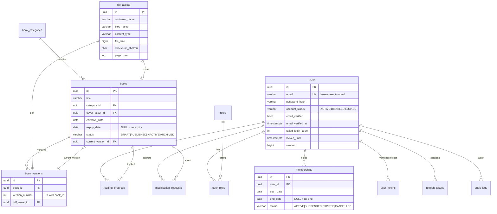

# Database ERD

Authoritative schema: `backend/src/main/resources/db/migration/V1__initial_schema.sql`.

## Constraints and rules

| Table | Constraint | Purpose |
|-------|-----------|---------|
| users | `email = lower(btrim(email))`, unique | Normalized unique email |
| users | `email_verified = false OR email_verified_at IS NOT NULL` | Consistent verification state |
| roles | name in (MEMBER, ADMIN) | No `GUEST` role in DB |
| memberships | `end_date >= start_date`; partial unique `(user_id) WHERE status='ACTIVE'` | Valid range; one active membership |
| user_tokens / refresh_tokens | unique `token_hash` (SHA-256 hex) | Raw tokens never stored |
| book_categories | unique `lower(name)` | Case-insensitive uniqueness |
| file_assets | `file_size > 0`; content_type allow-list; unique (container, blob) | No empty/unknown files |
| books | `expiry_date >= effective_date`; PUBLISHED ⇒ `current_version_id` not null | Valid window; no published book without PDF |
| books → book_versions | composite FK `(current_version_id, id)` → `(id, book_id)`, deferrable | Current version must belong to the same book |
| book_versions | unique (book_id, version_number); `version_number > 0` | Ordered history |
| reading_progress | unique (user_id, book_id); `last_page >= 1` | One row per user/book |
| modification_requests | reviewed_at set iff status ≠ PENDING | Consistent review state |

## Deletion / archival

- Users: never hard-deleted in v1 (disable instead). FKs from history tables use `RESTRICT`/`SET NULL`.
- Books: archived, never deleted. `book_versions` and `file_assets` use `RESTRICT`.
- Categories: deactivated; `RESTRICT` while referenced.
- Tokens: cascade-deleted with user; expired rows purged by a scheduled job (Phase 3).

## Indexes

Email (unique), `user_roles(role_id)`, `memberships(user_id,status,start_date,end_date)`,
`books(status,effective_date,expiry_date)`, `books(category_id)`, `books(lower(title))`,
`reading_progress(user_id,updated_at desc)`, `audit_logs(created_at)`, `(actor,created_at)`,
`(entity_type,entity_id)`, `(action,created_at)`, `modification_requests(status,created_at)`.
Full-text search (`tsvector` on title+description) can be added in Phase 7 if `ILIKE` is too slow.
